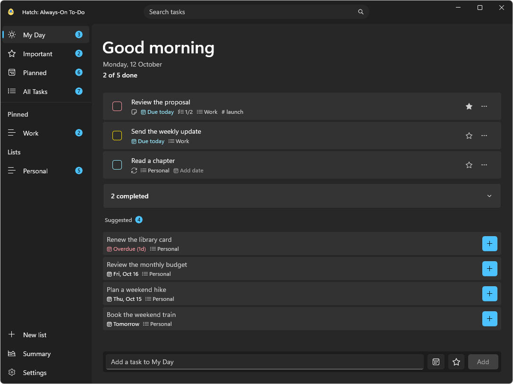
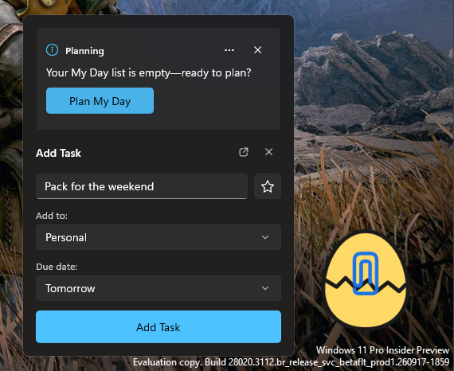
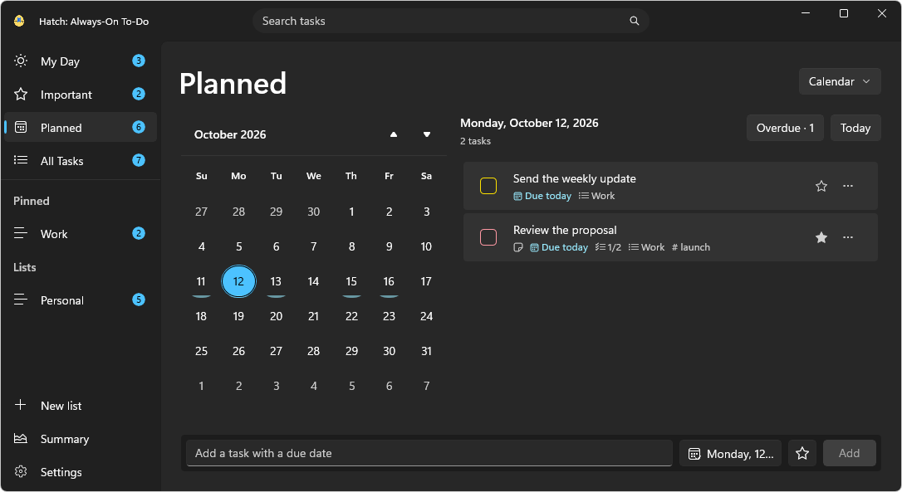
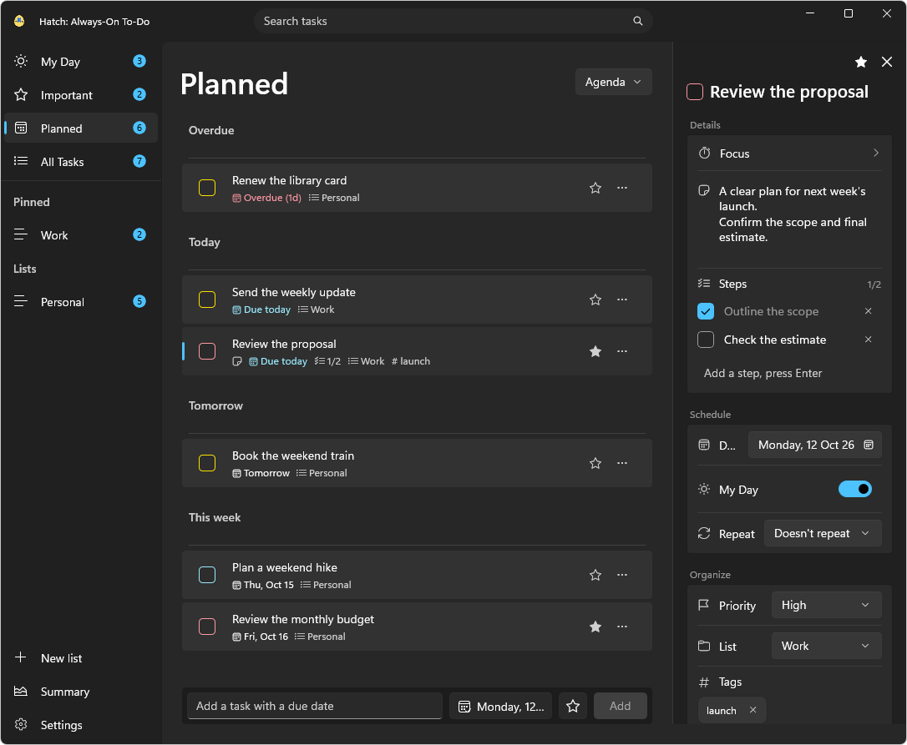

<div align="center">
  
  <h1>Hatch</h1>
  <p>A local-first Windows to-do app with an always-on-top mascot for quick task capture.</p>
  <p>
    
    
    
    
  </p>
  <p>
    <a href="https://apps.microsoft.com/detail/9PKTQFG9S3K8"></a>
    <a href="https://fbtwitter.github.io/hatch/Hatch.appinstaller"></a>
    <a href="https://github.com/fbtwitter/hatch/releases"></a>
  </p>
</div>



Capture a task when it comes to mind. Choose what matters today, and keep upcoming deadlines in view.

## Features

- **Quick capture:** add tasks from the desktop mascot, with optional due dates and an Important mark.
- **Your daily plan:** choose tasks for My Day and see your progress as you complete them.
- **Upcoming deadlines:** browse Planned as an agenda or calendar, see tasks due on a selected day, and jump to overdue tasks.
- **Details when you need them:** organize tasks with custom lists, notes, tags, priorities, recurring tasks, and checklists.
- Use Focus Mode and the Windows 11 My Day widget.
- Keep tasks on your device or enable end-to-end encrypted sync with the [Android companion](https://github.com/fbtwitter/hatch-mobile).

## A closer look

### Capture from your desktop

Click the mascot to open Quick Add. Give the task a title, choose its list, and add a due date or mark it Important before saving.

<p align="center">
  
</p>

### See what's due

Planned opens as an agenda. Switch to Calendar to browse deadlines by day; choosing a date also sets the due date for a fresh task draft. An Overdue shortcut keeps missed deadlines within reach.



### Keep the next step clear

Break a bigger task into steps and keep useful notes alongside it. Set a due date and priority, or use the separate Important star to keep it within reach.



*The task-list examples use sample tasks.* [Browse all screenshots](docs/screenshots/).

## Install

**Microsoft Store:** [Install Hatch](https://apps.microsoft.com/detail/9PKTQFG9S3K8). No certificate setup is needed. Store releases may lag behind GitHub releases.

**GitHub release:** For background updates, install the signing certificate from the [latest release](https://github.com/fbtwitter/hatch/releases/latest) once, then open the [App Installer feed](https://fbtwitter.github.io/hatch/Hatch.appinstaller) and select **Install**. Install the certificate to **Local Machine > Trusted People**.

## Build and run without an IDE

On Windows 10 (build 17763+) or Windows 11, install the [.NET 10 SDK](https://dotnet.microsoft.com/download/dotnet/10.0) and the [Windows App SDK 2.5.1 runtime](https://learn.microsoft.com/en-us/windows/apps/windows-app-sdk/downloads). The Debug build is unpackaged and needs that runtime installed. You also need internet access for the first NuGet restore. Visual Studio or JetBrains Rider does not need to be open.

Open PowerShell in the repository root and run:

```powershell
dotnet restore .\windows\hatch.csproj -p:Platform=x64
dotnet build .\windows\hatch.csproj -c Debug --no-restore -p:Platform=x64
dotnet run --project .\windows\hatch.csproj -c Debug --no-build -p:Platform=x64 --no-launch-profile
```

The `dotnet build` command builds Hatch without opening it; only `dotnet run` launches the app. Use the full word `Debug` for the configuration. If you are setting up a new PC, Microsoft's [command-line WinUI setup guide](https://learn.microsoft.com/en-us/windows/apps/get-started/start-here?tabs=stable) covers the required development tools. See the [contributing guide](.github/CONTRIBUTING.md) for more project details.

## Privacy

Tasks are stored in `%LocalAppData%\Hatch` by default. No account or internet connection is required to use Hatch. Optional sync is off until you sign in, and the app includes no analytics or remote crash reporting.

Read the [privacy policy](PRIVACY.md).

## Troubleshooting

**Crash diagnostics:** Hatch writes startup and unhandled exception details to `%LocalAppData%\Hatch\crash.log` in Debug and installed builds. The log stays on your device and may contain task data in exception details. Some native WinUI crashes bypass this log. To capture a local minidump for those crashes during development, run `windows\scripts\enable-crash-dumps.ps1` from an elevated PowerShell window. Windows saves dumps to `%LocalAppData%\CrashDumps` for the crashing user. Dumps may contain task data, so review them before sharing. This opt-in setting applies to `hatch.exe` until you remove its `HKLM:\SOFTWARE\Microsoft\Windows\Windows Error Reporting\LocalDumps\hatch.exe` registry key.

**Remove the shadow around the mascot:** Search Windows for **Adjust the appearance and performance of Windows**, then clear **Show shadows under windows**. Windows does not offer a per-app setting to disable this shadow.

## Project links

[Screenshots](docs/screenshots/) · [Changelog](CHANGELOG.md) · [Roadmap](.github/ROADMAP.md) · [Architecture](.github/ARCHITECTURE.md) · [License](LICENSE)
